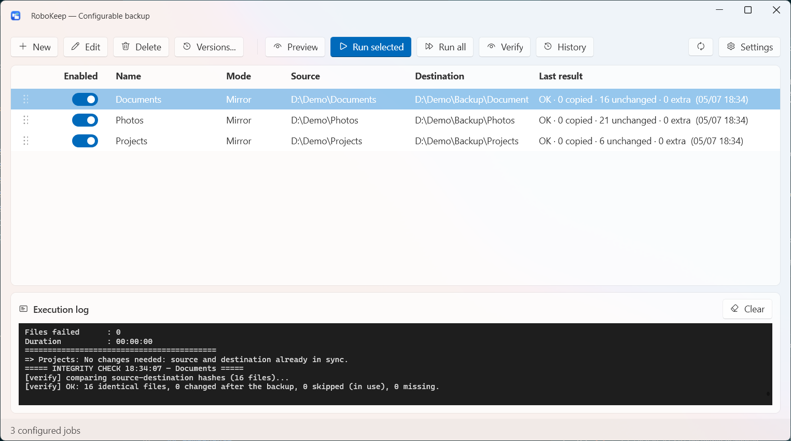
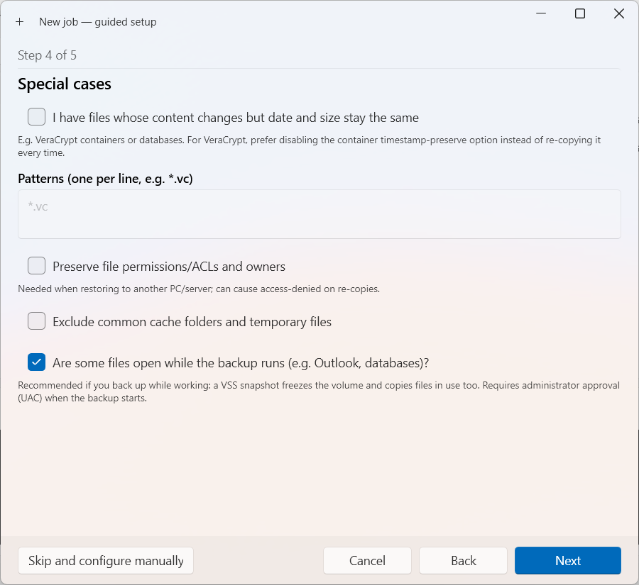
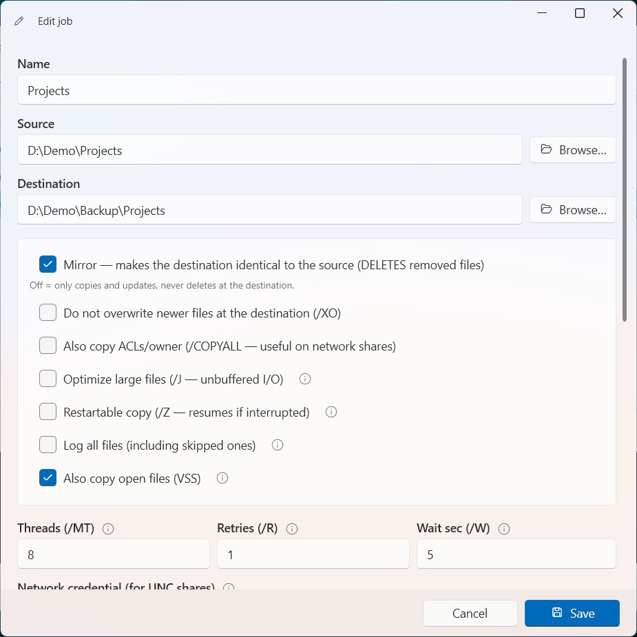
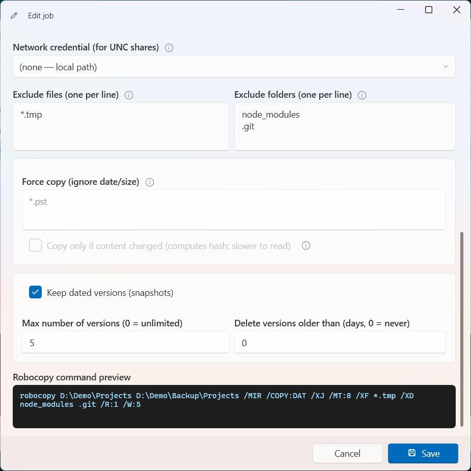
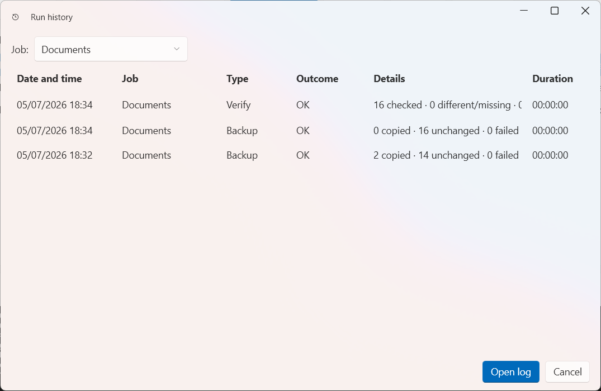
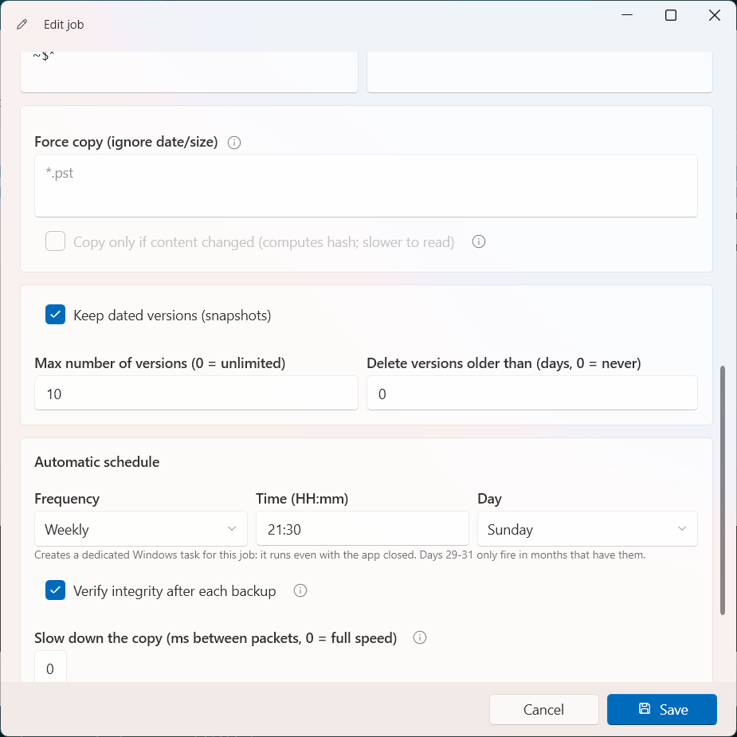
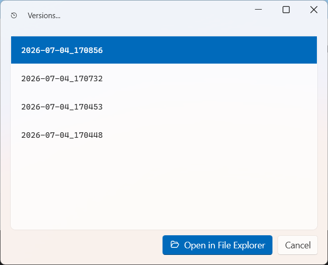

# RoboKeep

*Read in: English · [Italiano](readmeita.md) · [Español](readmees.md) · [Français](readmefr.md) · [Deutsch](readmede.md)*

**Set it up once. Every file, every version, safe on your own disk.**


[](LICENSE)
[](../../releases)

RoboKeep is a Windows backup app built on `robocopy`, the copy engine already inside every PC.
Answer a few questions, and it keeps your folders mirrored to an external disk, with dated
versions you can go back to. **No cloud, no account, no subscription.**



## Why RoboKeep

### Simple to start, clever with space

| | |
|---|---|
| 🧙 **Guided setup** | Answer a few plain questions and RoboKeep sets everything up properly. Experts keep full manual control.<br>*✓ Start the easy way* |
| 🕰️ **History without waste** | Dated versions that store only the files changed or deleted.<br>*✓ Ten revisions in the space of one* |
| ↩️ **Pinpoint restore** | Get back a file, a folder or the whole job exactly as it was on a given date, wherever you want it.<br>*✓ Pick what and when* |

### Kind to your hardware, sure about your disks

| | |
|---|---|
| 💿 **Respect for your disks** | Stops at the first hardware error to protect the drive. The PC stays awake during the backup.<br>*✓ Your drives protected* |
| 🩺 **SMART health at a glance** | Disk status with plain verdicts and every value explained.<br>`Good` · `Caution` · `Danger` |
| 🛡️ **Knows its own disk** | Two external drives that Windows both calls `E:`? Each job recognises its own and simply waits for it.<br>*✓ Never the wrong disk* |

### Rock-solid, private, no strings attached

| | |
|---|---|
| ✅ **SHA-256 verify and open files** | Catches silent corruption, and takes in locked files or Outlook archives through shadow copies (VSS).<br>*✓ Proof it worked* |
| ⏰ **Quietly self-sufficient** | Per-job scheduling, even with the app closed. Sober notifications, only when they matter.<br>*✓ Runs by itself* |
| 🏠 **100% yours and open source** | MIT license, zero telemetry, everything local. Five languages and a portable build ready to go.<br>*✓ Your files, under your control* |

## Get started in two minutes

1. Download the latest version from **[Releases](../../releases)**:
   - **`…-selfcontained.zip`**: extract and run, nothing to install (larger download);
   - **`…-framework-dependent.zip`**: much smaller, needs the free
     [.NET 10 Desktop Runtime](https://dotnet.microsoft.com/download/dotnet/10.0).
2. Extract it into any **writable folder**, e.g. `D:\Programs\RoboKeep` (not `C:\Program Files`).
3. Run **`RoboKeep.exe`** → **New** → answer the wizard → **Run all**. Done.

> **Windows SmartScreen warns you?** RoboKeep isn't digitally signed yet. Click *More info* →
> *Run anyway*, or right-click the zip → Properties → **Unblock** before extracting.

## See it in action

| | |
|---|---|
|  | **Guided setup.** A few questions, including whether files stay open while you work, and the job is configured for you. |
|  | **Everything under control.** Mirror or accumulate, open-file copying, large-file options, each explained in one line. |
|  | **Nothing hidden.** Dated versions, per-job exclusions, and the exact robocopy command always in view. |
|  | **Every run on record.** Backups and integrity checks side by side; double-click opens the full log. |
|  | **Set it and forget it.** Daily, weekly, or monthly, plus periodic integrity checks. |
|  | **Pick a date.** What that backup replaced or deleted opens in File Explorer; *Restore* rebuilds the whole tree. |

## How a backup behaves

Each job is a source folder → destination folder pair. On every run RoboKeep:

- **skips** what hasn't changed (the second run takes seconds);
- **updates** what's newer in the source;
- in **mirror** mode (default) also **removes** from the destination what you deleted;
- with mirror off, only adds and updates, **never deletes**.

With versions on, the previous state of every file about to be replaced or deleted is set aside
in a dated version first.

Full history in the [CHANGELOG](CHANGELOG.md).

<details>
<summary><b>All the features</b></summary>

**Backing up**: mirror or accumulate · disk-rotation protection (job tied to its disk by volume
identity) · dated versions on any disk with configurable retention, no empty version when
nothing changed · open/locked file copying via VSS · SHA-256 integrity verification, on demand or
periodic · hardware-error stop that rests the disk · automatic thread cap on mechanical disks ·
PC kept awake · multi-threaded copying · per-job exclusions · "force copy" for files whose
date/size never change, with an optional content-hash mode · restartable mode for huge files ·
preview / dry-run.

**Keeping you informed**: run history with a log for every entry, opened in Notepad · Log folder
button · per-job health icons with plain tooltips · icons that refresh the instant you plug or
unplug a disk · pre-run checks (destination reachable, disk space, VSS eligibility,
recent disk errors from the Windows event log) · disk health window (SMART) · real-time log ·
zipped log archive with automatic cleanup · toast notifications and system tray · email reports
(SMTP), optionally only on errors.

**Fitting your setup**: wizard or full manual editor · exact command preview · per-job scheduling
(daily / weekly / monthly / last day of the month) · network shares with DPAPI-encrypted
credentials · copy throttling for network backups · configuration export/import · command line
for automation · drag & drop job ordering · optional update check · 5 languages · portable mode.

</details>

<details>
<summary><b>Good to know</b></summary>

- **Windows 10/11 only.** RoboKeep builds on robocopy and other Windows-native features.
- **Changed files are recopied whole** (no block-level delta): fine for documents and photos,
  costly for single huge files that change daily.
- **Open-file copying needs a local NTFS source** and one administrator confirmation (UAC) per run.
- **Integrity checks re-read every file on both sides**, so they take about as long as a first
  backup. That's why the automatic check runs every 7 days by default (0 = after every run).
- **A hardware error stops the job on purpose.** Before re-running, check cable, USB enclosure and
  power supply (on external disks they cause the very same errors as a failing disk), then open
  **Disk health**.
- Settings, results and logs live in `%APPDATA%\RoboKeep` and survive updates. Passwords are
  encrypted with Windows DPAPI; the default scope is machine-wide so scheduled tasks can read
  them. On a shared PC, switch to per-user scope.

</details>

<details>
<summary><b>For power users</b></summary>

```text
RoboKeep.exe --run-all              run all enabled jobs (exit code 0 = all good)
RoboKeep.exe --job "Documents"      run a single job
RoboKeep.exe --run-all --dry-run    preview only, nothing changes
RoboKeep.exe --job "Photos" --config "D:\path\config.json"
```

Build from source: `dotnet build src/RoboKeep.sln -c Release` (.NET 10 SDK); tests:
`dotnet test src/RoboKeep.Tests/RoboKeep.Tests.csproj`. Portable mode: an empty `portable.flag`
next to the exe keeps everything in the app folder. Sample config:
[config/config.example.json](config/config.example.json). Background and technical decisions:
[ANALISI.md](ANALISI.md) *(in Italian)*.

</details>

## Privacy

RoboKeep collects **nothing**. No telemetry, no analytics, no account. The only network traffic is
what you enable yourself: the optional update check (one request to GitHub) and email reports
(your SMTP server, TLS by default). Everything it knows lives in readable JSON files on your PC.

## Code signing policy

Releases are currently **unsigned**: Windows SmartScreen shows "unknown publisher" the first time
you run a new version (see *Get started*). We intend to sign them through
[SignPath Foundation](https://signpath.org) (free code signing for open source, certificate in
the Foundation's name), which asks for a level of public visibility the project does not have
yet; we will apply once it does. The first signed release will say so in the changelog.

- **Committers and reviewers**: [Roberto Serafini](https://github.com/robisera-ai)
- **Approvers**: [Roberto Serafini](https://github.com/robisera-ai)

Only the release workflow ([`.github/workflows/release.yml`](.github/workflows/release.yml))
submits builds for signing, from a tag on `main`; a build made on a developer machine is never
signed and never published. Every signing request is approved by hand.

Privacy policy: RoboKeep collects nothing, see [Privacy](#privacy) above and the
[privacy chapter of the guide](docs/guide/en/17-privacy-security.md).

## Contributing

Translations are community-maintained: spotted a wording a native speaker would phrase better?
[Pull requests are welcome](../../pulls), even a one-line fix.

## License

**MIT License**, see [LICENSE](LICENSE). Third-party components in
[THIRD-PARTY-NOTICES.md](THIRD-PARTY-NOTICES.md). © 2026 Roberto Serafini.
